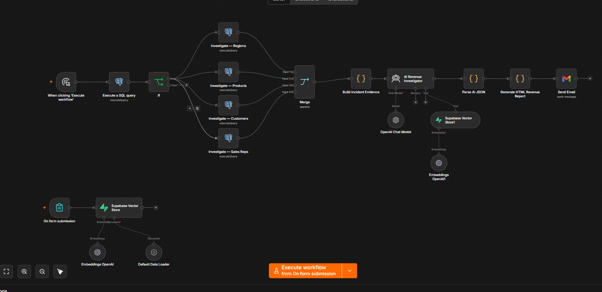

# AI-Powered-Sales-Revenue-Investigator-with-RAG
Intelligent AI investigation system that  automatically detects revenue anomalies  across regions, products, customers and  sales reps using PostgreSQL queries.  Combines RAG (Retrieval Augmented Generation)  with Supabase Vector Store and OpenAI embeddings  to build evidence-backed investigation reports  delivered automatically via email.

# AI-Powered Sales Revenue Investigator with RAG
**Tools:** n8n | PostgreSQL | Supabase | OpenAI | Gmail  
**Type:** AI Agent + RAG Automated Investigation  
**Industry:** Pharmaceutical Distribution / Sales Analytics

## Project Overview
Built an intelligent on-demand revenue 
investigation system that management triggers 
with a single click when they suspect sales 
are dropping.

The system runs parallel SQL investigations 
across all sales dimensions simultaneously, 
then feeds the evidence into an AI agent 
that benchmarks findings against embedded 
company sales policies stored in Supabase 
Vector Store — delivering a policy-backed 
executive investigation report via email 
in seconds.

## The Business Problem
When management suspected sales were dropping 
they previously had to:
- Manually check multiple spreadsheets
- Chase different teams for regional data
- Wait hours or days for a compiled picture
- Make critical decisions on incomplete 
  and unverified information

Now they click one button and receive a 
full AI-powered, policy-benchmarked 
investigation report instantly.

## What Makes This Unique
The AI agent does not just detect anomalies 
— it investigates them against the company's 
own sales policies.

Company sales policies and performance 
benchmarks are embedded into a Supabase 
Vector Store using OpenAI embeddings. 
When an investigation is triggered, the 
AI agent retrieves these policies and uses 
them as the official benchmark to determine 
whether current sales performance represents 
a genuine drop or falls within acceptable 
thresholds.

This makes every investigation:
- Policy-driven not just data-driven
- Consistent with company standards
- Defensible and evidence-backed
- Ready to present to leadership

## How It Works
Management clicks “Execute Workflow”
↓
PostgreSQL query checks overall revenue
↓
If condition — anomaly threshold check
↓
Parallel SQL investigations triggered:
├── Investigate — Regions
├── Investigate — Products
├── Investigate — Customers
└── Investigate — Sales Reps
↓
Merge all investigation evidence
↓
Build Incident Evidence package
↓
AI Revenue Investigator (RAG Agent)
Retrieves company sales policies
from Supabase Vector Store and
benchmarks evidence against them
↓
Parse AI JSON response
↓
Generate HTML Revenue Report
↓
Send Email to management

## Tech Stack

Database: PostgreSQL (live production data)
Vector Store: Supabase (embedded company policies)
Embeddings: OpenAI Embeddings
AI Agent: n8n AI Agent with RAG
LLM: OpenAI GPT
Automation: n8n
Reporting: Formatted HTML Email via Gmail
Trigger: Manual on-click by management

## Key Features

✅ On-demand trigger — management decides
when to investigate, not a fixed schedule

✅ Parallel investigation — 4 dimensions
analysed simultaneously saving time

✅ Policy-embedded RAG — company benchmarks
stored as vectors and used by AI as
the official investigation standard

✅ PostgreSQL integration — queries live
production database not static files

✅ Evidence-based AI analysis — root cause
investigation not just anomaly flagging

✅ Executive HTML report — formatted
professional report delivered instantly
to management inbox

## Workflow Nodes
Manual Trigger (on-click)
Execute SQL Query (revenue check)
If node (anomaly threshold)
Investigate — Regions (SQL)
Investigate — Products (SQL)
Investigate — Customers (SQL)
Investigate — Sales Reps (SQL)
Merge (combine all evidence)
Build Incident Evidence
AI Revenue Investigator (RAG Agent)
Parse AI JSON
Generate HTML Revenue Report
Send Email to management

## Skills Demonstrated
- PostgreSQL query design for 
  business intelligence
- n8n advanced workflow architecture
- AI Agent configuration and deployment
- RAG implementation with Supabase 
  Vector Store
- OpenAI embeddings for policy storage
- Parallel workflow execution
- Evidence package construction
- Policy-benchmarked AI investigation
- Automated executive HTML reporting

## Workflow Preview

